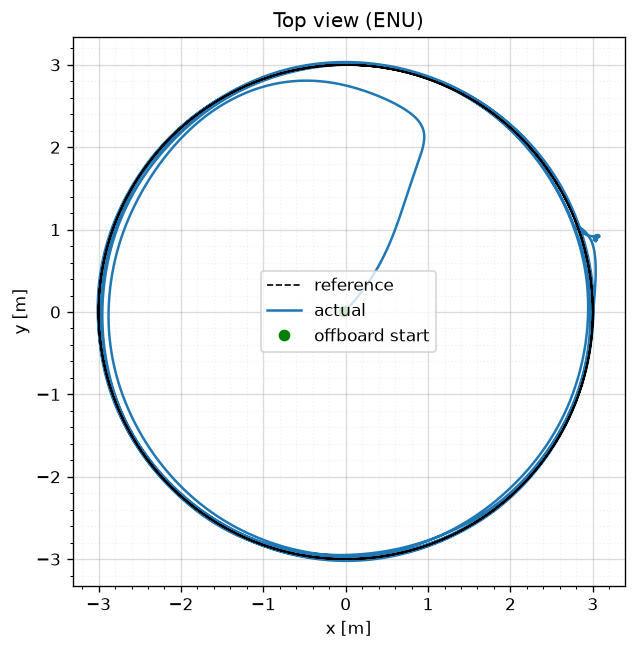
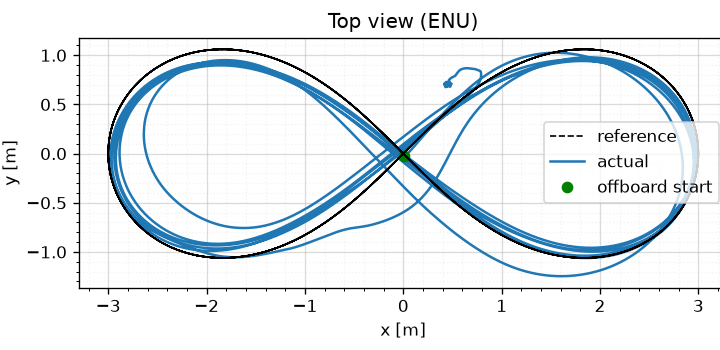

<div align="center">

# 🛸 QuatInnerMPC

**Quaternion NMPC that flies a PX4 quadrotor directly on thrust and body torques**


<table>
<tr>
<td align="center"></td>
<td align="center"></td>
</tr>
<tr>
<td align="center"><sub>3 m circle, 1.9 m/s · 11 cm RMS</sub></td>
<td align="center"><sub>6 × 2 m figure-8, up to 1.9 m/s · 16 cm RMS</sub></td>
</tr>
</table>

*SITL, Gazebo `gz_x500`, MPC on a Raspberry Pi 5 (about 2 ms per solve)*

</div>

Replaces PX4's position, attitude and rate loops. At 120 Hz the node solves a 20-stage, 0.4 s OCP from the full state and sends normalised thrust and torque to PX4's allocator (`thrust_and_torque` offboard mode).

## 🧠 How it works

- **Runs only when armed + OFFBOARD.** The node never arms or takes off.
- **Time grid:** the first 6 stages are one control period (8.33 ms) and the remaining 14 are 25 ms, keeping a 0.4 s horizon at the cost of an N = 20 solve (1.8 ms on the Pi). References are sampled at each stage's actual time; trajectory files are resampled to the control period when loaded.
- **Delay compensation:** before each solve, the measured state is integrated through the commands sent in the last `actuation_delay` seconds, which are sent but not yet acting on the vehicle. If no new state has arrived for more than one step, it is also integrated through the commands sent since. Beyond `max_state_age` the node stops commanding and withholds the heartbeat, so PX4's offboard-loss failsafe takes over.
- **Model:** a rigid body. State `[p, v, q, ω]` (ENU / FLU), input `[F, τx, τy, τz]` in N and Nm. No drag, motor dynamics or delay.
- **Cost:** nonlinear least squares on position, velocity, quaternion-error vector, body-rate and `u − u_hover` residuals against a per-stage reference. Bounds: `0 ≤ F ≤ F_max`, `|τ| ≤ τ_max`.
- **Solver:** SQP-RTI (Gauss-Newton), HPIPM partial condensing, explicit RK4 (3 steps per interval).
- **Output:** thrust inverts Gazebo's motor curve (simulation-specific); torque is `τ_FRD / τ_max`, clipped to ±1.

## 🚀 Quick start

**Needs:** ROS 2 Jazzy, [acados](https://docs.acados.org/installation/) with its Python interface (`ACADOS_SOURCE_DIR`, `LD_LIBRARY_PATH`), `pip install scipy matplotlib cython deprecated casadi pyulog "numpy<2"`, Micro XRCE-DDS Agent, and a [`px4_msgs`](https://github.com/PX4/px4_msgs) that **matches your PX4 version**.

```bash
cd ~/ros2_ws && colcon build --symlink-install --packages-select px4_mpc && source install/setup.bash

# offline benchmark (no PX4): timing + tracking plot
cd src/QuatInnerMPC && python3 -m px4_mpc.utils.benchmark_inner_mpc --plot tracking.png

# trajectories (.npz sampled at 0.02 s): hover, takeoff, circle, figure-8, B-spline
python3 -c "from px4_mpc.utils.trajectory import *
generate_hover_trajectory(60.0, 0.02, [0., 0., 3.], '$HOME/trajectories/hover.npz')
generate_circle_trajectory(60.0, 0.02, 3.0, 3.0, 0.1, '$HOME/trajectories/circle.npz')"
```

The acados solver is generated in `px4_mpc/mpc_codegen/` on first start (about 15 s) and reused afterwards. It regenerates automatically when weights or constraints change; delete the folder after changing the model.


## ⚙️ Configuration

| Launch argument | Default | |
|:--|:--|:--|
| `trajectory_path` | `''` | `~` is expanded; empty → static hover at (0, 0, 3); missing file → node refuses to start |
| `control_rate` | `120` | Hz; any rate whose 0.4 s grid fits (50 → uniform 20 × 20 ms) |
| `actuation_delay` | `0.04` | s to propagate ahead (rounded to whole periods); `0` = off |
| `max_state_age` | `0.2` | s; older state → stop commanding (set PX4's `COM_OF_LOSS_T` short) |
| `log_dir` | `~/mpc_logs` | `''` disables logging |
| `rviz` | `true` | use `false` unless `px4_offboard` is installed |

**`actuation_delay`:** SITL measured about 40 ms end to end. Without compensation the loop diverges somewhere between 40 and 60 ms, at 50 Hz and 120 Hz alike, so it was at the edge; a faster loop doesn't add margin. With 40 ms set, the simulated loop tolerates real delays up to about 75 ms. A fast oscillation means the value is too high.

**Model** (`models/multirotor_inner_model.py`, Gazebo x500 values): mass 2.0 kg, J = diag(0.0217, 0.0217, 0.04) kg·m², arms ±0.174 m, τ_max = 2.97 / 2.97 / 0.55 Nm, F_max = 34.2 N.

**Weights** (`controllers/multirotor_inner_mpc.py`): `Q_p = 100·I`, `Q_v = 20·I`, `Q_q = 10·I`, `Q_w = diag(1, 10, 5)`, `R = diag(10, 50, 100, 50)`.

## 📈 Logging & analysis

Each run writes `~/mpc_logs/<date>_<time>.npz`: one row per control step, with the state (measured and delay-compensated), reference, raw and normalised output, solver status and timing, input ages and the predicted horizon.

```bash
python3 -m px4_mpc.utils.plot_node_log ~/mpc_logs/<run>.npz           # timing, commands, prediction vs measurement
python3 -m px4_mpc.utils.plot_ulog <log>.ulg --traj <trajectory>.npz  # PX4 log vs reference
```

## 📊 Results (SITL, Wi-Fi link)

**Hover, with and without delay compensation:**

| (50 Hz) | no compensation | 40 ms compensation |
|:--|:--:|:--:|
| Pitch rate | ±7 rad/s, 3.4 Hz | **±0.01 rad/s** |
| Motors pinned at 0 or 1 | 73% | **0%** |
| Horizontal error (RMS) | — | **1 cm** |
| Outcome | 💥 fell | ✅ stable |

| No compensation | 2-step compensation |
|:--:|:--:|
|  |  |

**Circle** (r = 3 m, 1.9 m/s, 50 Hz): 11.4 cm horizontal RMS (radial 3.1 cm, along-track 10.6 cm behind), yaw 3.4° behind, 0 solver failures. It recovered from a 3 m / 100° reference jump at the start within 5 s.


**Figure-8** (6 × 2 m, up to 1.9 m/s, 120 Hz): 16 cm horizontal RMS, yaw 3.0° RMS, 0 solver failures, solve 1.8 ms. At 49 s a burst of Wi-Fi stalls (state up to 129 ms old) during the tightest part of a lobe caused a 2 m altitude dip, which it recovered from.

## 🗺️ Known issues

- **Altitude offset (−0.32 m):** about 3% thrust mismatch (likely rotor masses) and no integral action.
- **Trajectory end:** holds the last velocity and yaw rate instead of zeroing them.
- **Trajectory start:** not aligned to the vehicle's position and heading when OFFBOARD engages.
- **Torque scaling:** `τ_max` assumes symmetric arms; PX4's allocator uses 0.13 / 0.22 m.
- **Hardware:** needs a measured thrust curve, real vehicle parameters and failsafes. Wi-Fi drops are another reason to use Ethernet or serial.

## 📁 Layout

```text
launch/mpc_inner_launch.py          launch + arguments
px4_mpc/mpc_inner_quadrotor.py      ROS 2 node
px4_mpc/models/                     CasADi model, vehicle constants
px4_mpc/controllers/                OCP, weights, codegen
px4_mpc/utils/                      trajectories, logger, plotters, benchmark
docs/results/                       figures
```

## 🙏 Acknowledgements

Built on [**px4-mpc**](https://github.com/Jaeyoung-Lim/px4-mpc) by [Jaeyoung Lim](https://github.com/Jaeyoung-Lim). The package structure, the acados model/controller layout and the `px4_mpc` name come from that project.
