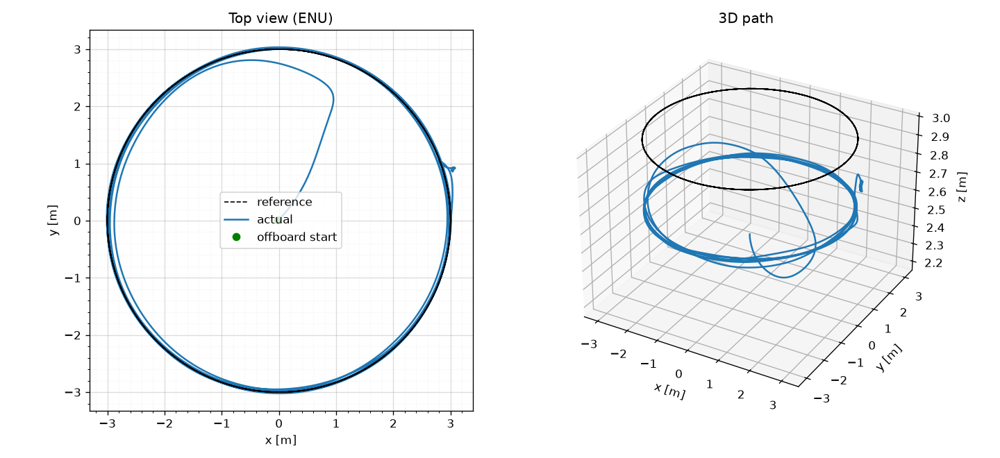
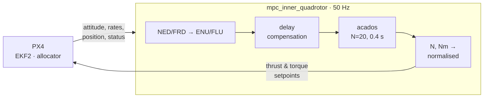
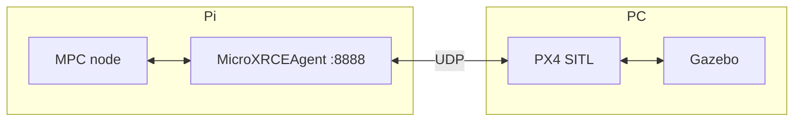
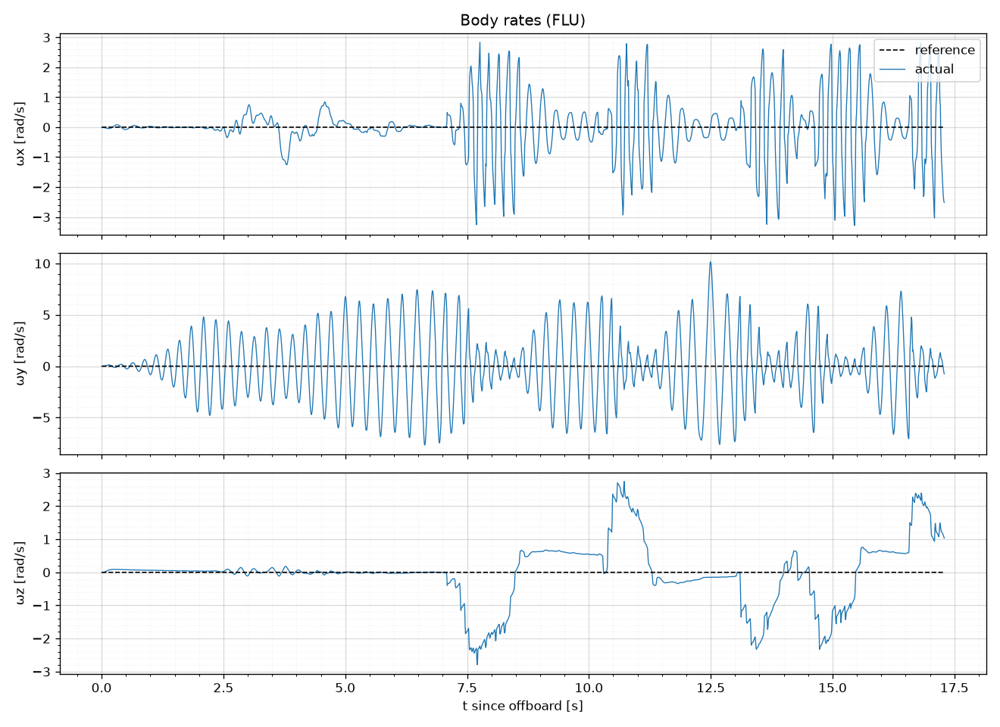
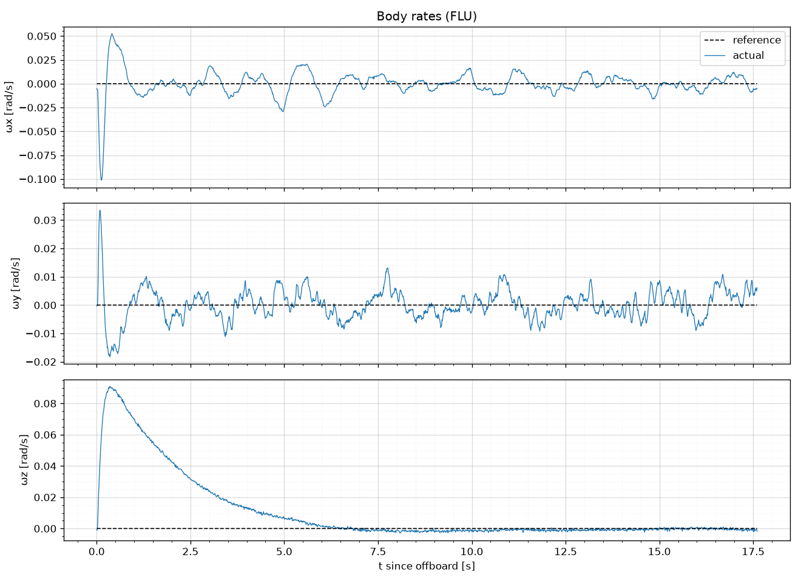
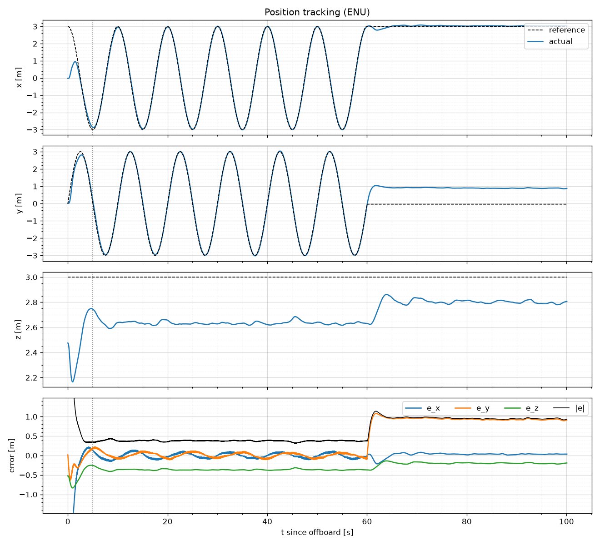

<div align="center">

# 🛸 QuatInnerMPC

**Quaternion NMPC that flies a PX4 quadrotor directly on thrust and body torques**




*SITL, Gazebo `gz_x500`: 3 m circle at 1.9 m/s, 11 cm RMS, MPC on a Raspberry Pi 5 (2.2 ms per solve)*

</div>

Replaces PX4's position, attitude and rate loops. At 50 Hz the node solves a 20-step OCP from the full state and sends normalised thrust and torque to PX4's allocator (`thrust_and_torque` offboard mode).

## 🧠 How it works



- **Runs only when armed + OFFBOARD.** The node never arms or takes off.
- **Delay compensation:** before each solve, the measured state is integrated through the last `delay_steps` commands, which are sent but not yet acting on the vehicle.
- **Model:** a rigid body. State `[p, v, q, ω]` (ENU / FLU), input `[F, τx, τy, τz]` in N and Nm. No drag, motor dynamics or delay.
- **Cost:** nonlinear least squares on position, velocity, quaternion-error vector, body-rate and `u − u_hover` residuals against a per-stage reference. Bounds: `0 ≤ F ≤ F_max`, `|τ| ≤ τ_max`.
- **Solver:** SQP-RTI (Gauss-Newton), HPIPM partial condensing, explicit RK4 (3 steps per interval).
- **Output:** thrust inverts Gazebo's motor curve (simulation-specific); torque is `τ_FRD / τ_max`, clipped to ±1.

## 🚀 Quick start

**Needs:** ROS 2 Jazzy, [acados](https://docs.acados.org/installation/) with its Python interface (`ACADOS_SOURCE_DIR`, `LD_LIBRARY_PATH`), `pip install scipy matplotlib cython deprecated casadi pyulog "numpy<2"`, Micro XRCE-DDS Agent, and a [`px4_msgs`](https://github.com/PX4/px4_msgs) that **matches your PX4 version**.

```bash
cd ~/ros2_ws && colcon build --symlink-install --packages-select px4_mpc && source install/setup.bash

# offline benchmark (no PX4): timing + tracking plot
cd src/QuatInnerMPC && python3 -m px4_mpc.utils.benchmark_inner_mpc --plot tracking.png

# trajectories (.npz sampled at 0.02 s): hover, takeoff, circle, figure-8, B-spline
python3 -c "from px4_mpc.utils.trajectory import *
generate_hover_trajectory(60.0, 0.02, [0., 0., 3.], '$HOME/trajectories/hover.npz')
generate_circle_trajectory(60.0, 0.02, 3.0, 3.0, 0.1, '$HOME/trajectories/circle.npz')"
```

The acados solver is generated in `px4_mpc/mpc_codegen/` on first start (about 15 s) and reused afterwards. It regenerates automatically when weights or constraints change; delete the folder after changing the model.

## 🌐 SITL: PX4 + Gazebo on a PC, MPC on the Pi



| Where | Step |
|:--|:--|
| Pi | `MicroXRCEAgent udp4 -p 8888` |
| PC | `export ROS_DOMAIN_ID=<Pi's ID>` in the same shell, then `make px4_sitl gz_x500` |
| PC `pxh>` | `uxrce_dds_client stop` then `uxrce_dds_client start -t udp -h <PI_IP> -p 8888` (or persist it with `param set UXRCE_DDS_AG_IP <int32 IP>`) |
| Pi | check: `ros2 topic hz /fmu/out/vehicle_attitude` |
| Pi | `ros2 launch px4_mpc mpc_inner_launch.py trajectory_path:=$HOME/trajectories/hover.npz rviz:=false` |
| PX4 | take off, hover near the trajectory start, switch to **OFFBOARD** |

> [!IMPORTANT]
> If `px4_msgs` doesn't match PX4, topics silently stop arriving or decode as garbage. Check out the `px4_msgs` commit titled `Update to PX4 <hash>` that matches your PX4 commit.

## ⚙️ Configuration

| Launch argument | Default | |
|:--|:--|:--|
| `trajectory_path` | `/home/dinesh/…/takeoff.npz` | missing file → static hover at (0, 0, 3) |
| `delay_steps` | `2` | steps of 20 ms to propagate ahead; `0` = off |
| `log_dir` | `~/mpc_logs` | `''` disables logging |
| `rviz` | `true` | use `false` unless `px4_offboard` is installed |

**`delay_steps`:** SITL measured about 2 steps (40 ms) of delay end to end. Without compensation the loop tolerates at most 2 steps, so it was at the edge. Being one step off either way is safe; a fast (~7 Hz) oscillation means the value is too high.

**Model** (`models/multirotor_inner_model.py`, Gazebo x500 values): mass 2.0 kg, J = diag(0.0217, 0.0217, 0.04) kg·m², arms ±0.174 m, τ_max = 2.97 / 2.97 / 0.55 Nm, F_max = 34.2 N.

**Weights** (`controllers/multirotor_inner_mpc.py`): `Q_p = 100·I`, `Q_v = 20·I`, `Q_q = 10·I`, `Q_w = diag(1, 10, 5)`, `R = diag(10, 50, 100, 50)`.

## 📈 Logging & analysis

Each run writes `~/mpc_logs/<date>_<time>.npz`: one row per control step, with the state (measured and delay-compensated), reference, raw and normalised output, solver status and timing, input ages and the predicted horizon.

```bash
python3 -m px4_mpc.utils.plot_node_log ~/mpc_logs/<run>.npz           # timing, commands, prediction vs measurement
python3 -m px4_mpc.utils.plot_ulog <log>.ulg --traj <trajectory>.npz  # PX4 log vs reference
```

## 📊 Results (SITL, Wi-Fi link)

**Hover, with and without delay compensation:**

| | `delay_steps:=0` | `delay_steps:=2` |
|:--|:--:|:--:|
| Pitch rate | ±7 rad/s, 3.4 Hz | **±0.01 rad/s** |
| Motors pinned at 0 or 1 | 73% | **0%** |
| Horizontal error (RMS) | — | **1 cm** |
| Outcome | 💥 fell | ✅ stable |

| No compensation | 2-step compensation |
|:--:|:--:|
|  |  |

**Circle** (r = 3 m, 1.9 m/s): 11.4 cm horizontal RMS (radial 3.1 cm, along-track 10.6 cm behind), yaw 3.4° behind, 0 solver failures. It recovered from a 3 m / 100° reference jump at the start within 5 s.



## 🗺️ Known issues

- **Altitude offset (−0.32 m):** about 3% thrust mismatch (likely rotor masses) and no integral action.
- **Trajectory end:** holds the last velocity and yaw rate instead of zeroing them.
- **Trajectory start:** not aligned to the vehicle's position and heading when OFFBOARD engages.
- **Torque scaling:** `τ_max` assumes symmetric arms; PX4's allocator uses 0.13 / 0.22 m.
- **Hardware:** needs a measured thrust curve, real vehicle parameters and failsafes. Wi-Fi drops are another reason to use Ethernet or serial.

## 📁 Layout

```text
launch/mpc_inner_launch.py          launch + arguments
px4_mpc/mpc_inner_quadrotor.py      ROS 2 node
px4_mpc/models/                     CasADi model, vehicle constants
px4_mpc/controllers/                OCP, weights, codegen
px4_mpc/utils/                      trajectories, logger, plotters, benchmark
docs/results/                       figures
```
