# 🚀 PX4 Inner-Loop Model Predictive Control (NMPC)

This documentation provides an in-depth guide to the **Inner-Loop Nonlinear Model Predictive Controller (NMPC)** designed for the PX4 quadrotor (specifically the `x500` frame in Gazebo SITL and hardware).

The controller bypasses the standard PX4 attitude and rate loops, taking full-state feedback and directly commanding normalized thrust and torque setpoints (`direct_actuator` or `thrust_and_torque` offboard modes) to the PX4 control allocator.

---

## 📌 Architecture & Control Pipeline

The NMPC controller runs as a high-frequency ROS 2 node (`mpc_inner_quadrotor`). The pipeline is as follows:

```mermaid
graph TD
    PX4[PX4 Autopilot SITL/Hardware] -->|fmu/out topics| Sub[Subscriber Callbacks]
    Sub -->|Raw States in NED/FRD| Trans[Coordinate Transformations]
    Trans -->|Full State x0 in ENU/FLU| Solver[Acados NMPC Solver]
    Traj[Trajectory Loader] -->|Lookahead Reference Parameters| Solver
    Solver -->|Optimal Control u0: F, tau_FLU| Normalise[Normalization & Frame Map]
    Normalise -->|thrust_norm, torque_norm| Pub[Publisher]
    Pub -->|fmu/in/vehicle_thrust_setpoint<br>fmu/in/vehicle_torque_setpoint| PX4
```



### 🔁 Threading & Frequencies
* **State Updates**: Asynchronous callbacks triggered by PX4 sensor publishers (typically 100-200 Hz).
* **Control Loop**: High-frequency periodic timer running at **50 Hz** ($\Delta t = 20\text{ ms}$), matching the prediction step size of the MPC solver to prevent discretization mismatches.

---

## 📐 Coordinate Frame Transformations

PX4 and standard multirotor kinematics use different coordinate systems. Keeping these consistent is vital to avoid instability.

| System | World Frame | Body Frame | Gravity Vector |
| :--- | :--- | :--- | :--- |
| **PX4 Autopilot** | **NED** (North-East-Down) | **FRD** (Forward-Right-Down) | Positive $Z$ ($+9.81\text{ m/s}^2$) |
| **Inner MPC / Acados** | **ENU** (East-North-Up) | **FLU** (Forward-Left-Up) | Negative $Z$ ($-9.81\text{ m/s}^2$) |

### 1. Position & Velocity Transformation (NED $\rightarrow$ ENU)
Position and velocity are transformed from NED to ENU frames:
$$
\begin{bmatrix} p_x \\ p_y \\ p_z \end{bmatrix}_{ENU} = \begin{bmatrix} p_y \\ p_x \\ -p_z \end{bmatrix}_{NED}, \quad \begin{bmatrix} v_x \\ v_y \\ v_z \end{bmatrix}_{ENU} = \begin{bmatrix} v_y \\ v_x \\ -v_z \end{bmatrix}_{NED}
$$

### 2. Angular Velocity Transformation (FRD $\rightarrow$ FLU)
Angular velocity rates published by PX4 in FRD are converted to FLU by flipping the $Y$ (pitch) and $Z$ (yaw) axes:
$$
\omega_{FLU} = \begin{bmatrix} \omega_x \\ -\omega_y \\ -\omega_z \end{bmatrix}_{FRD}
$$

### 3. Attitude Quaternion Transformation (NED $\rightarrow$ ENU)
Let $q_{PX4} = [w, x, y, z]$ be the quaternion representing rotation from NED to FRD. The attitude is converted to the ENU-to-FLU quaternion $q_{ENU}$ using:
$$
q_{ENU} = \frac{1}{\sqrt{2}} \begin{bmatrix} q_w + q_z \\ q_x + q_y \\ -q_x + q_y \\ -q_w + q_z \end{bmatrix}
$$
The resulting quaternion is normalized to maintain unit length: $q = \frac{q_{ENU}}{\|q_{ENU}\|}$.

### 4. Control Outputs Normalization (FLU $\rightarrow$ FRD)
The optimal solver output is a thrust $F\text{ [N]}$ and torque vector $\tau = [\tau_x, \tau_y, \tau_z]^T\text{ [Nm]}$ in FLU.
* **Thrust Normalization**: PX4 expects a normalized value in $[-1, 0]$ for the body-z axis where a negative value represents upward thrust:
  $$
  T_{norm} = -\text{clip}\left(\frac{F}{F_{max}}, 0, 1\right)
  $$
* **Torque Normalization**: Torques are mapped back to FRD by flipping the $Y$ and $Z$ axes, then normalized to $[-1, 1]$:
  $$
  \tau_{FRD} = \begin{bmatrix} \tau_x \\ -\tau_y \\ -\tau_z \end{bmatrix}, \quad \tau_{norm} = \text{clip}\left(\frac{\tau_{FRD}}{\tau_{max}}, -1, 1\right)
  $$

---

## 🧮 Mathematical Model & Optimal Control Problem (OCP)

### State and Input Vectors
The state vector $x \in \mathbb{R}^{13}$ and control input $u \in \mathbb{R}^4$ are defined as:
$$
x = \begin{bmatrix} p \\ v \\ q \\ \omega \end{bmatrix} = \begin{bmatrix} \text{Position } [x, y, z]^T \\ \text{Velocity } [v_x, v_y, v_z]^T \\ \text{Attitude Quaternion } [q_w, q_x, q_y, q_z]^T \\ \text{Body Rates } [\omega_x, \omega_y, \omega_z]^T \end{bmatrix}, \quad u = \begin{bmatrix} F \\ \tau_x \\ \tau_y \\ \tau_z \end{bmatrix} = \begin{bmatrix} \text{Total Thrust } [N] \\ \text{Roll Torque } [Nm] \\ \text{Pitch Torque } [Nm] \\ \text{Yaw Torque } [Nm] \end{bmatrix}
$$

### System Dynamics
The continuous-time system dynamics $\dot{x} = f(x, u)$ are modeled as:
$$
\dot{p} = v
$$
$$
\dot{v} = \frac{1}{m} R(q) \begin{bmatrix} 0 \\ 0 \\ F \end{bmatrix} + g
$$
$$
\dot{q} = \frac{1}{2} \Lambda(\omega) q
$$
$$
\dot{\omega} = J^{-1} \left( \tau - \omega \times (J \omega) \right)
$$
Where:
* $R(q)$ is the rotation matrix from the body frame (FLU) to the spatial frame (ENU).
* $\Lambda(\omega)$ is the skew-symmetric quaternion rate matrix.
* $J$ is the inertia tensor of the quadrotor.
* $g = [0, 0, -9.81]^T$ is the gravity vector.

### OCP Cost Function
The stage and terminal costs are formulated as **nonlinear least squares** (`NONLINEAR_LS`), with the quaternion error as a residual. See [INNER_MPC_SOLVER_PERFORMANCE.md](INNER_MPC_SOLVER_PERFORMANCE.md) for the exact residuals and weights:
$$
L(x, u, x_{ref}, u_{ref}) = \|p - p_{ref}\|_{Q_p}^2 + \|v - v_{ref}\|_{Q_v}^2 + e_{quat}(q_{ref}, q)^T Q_q e_{quat}(q_{ref}, q) + \|\omega - \omega_{ref}\|_{Q_\omega}^2 + \|u\|_{R_{cost}}^2
$$
The quaternion error $e_{quat}(q_{ref}, q)$ represents the vector part of the error quaternion:
$$
q_{err} = q_{ref}^{-1} \otimes q = \begin{bmatrix} w_{err} \\ \mathbf{v}_{err} \end{bmatrix} \implies e_{quat}(q_{ref}, q) = \mathbf{v}_{err}
$$

### Solver Parameters
The optimization problem is solved using the **Acados NLP solver**:
* **Horizon Length ($T_f$)**: $1.0\text{ s}$
* **Number of Shooting Steps ($N$)**: $20$
* **Discretization Method**: Explicit Runge-Kutta 4th order (ERK4)
* **NLP Solver**: Real-Time Iteration Sequential Quadratic Programming (`SQP_RTI`)
* **QP Solver**: `PARTIAL_CONDENSING_HPIPM`
* **Hessian Approximation**: Gauss–Newton (`GAUSS_NEWTON`). The exact-Hessian setup is kept commented out in `multirotor_inner_mpc.py`; it was about 3× slower per solve with the same tracking (see [INNER_MPC_SOLVER_PERFORMANCE.md](INNER_MPC_SOLVER_PERFORMANCE.md)).

---

## ⚙️ Configuration & Tuning

### 1. Actuator Scaling & Limits
Physical parameters are configured in `multirotor_inner_model.py`:
* **Mass ($m$)**: $2.0\text{ kg}$
* **Inertia ($J$)**: $\text{diag}(0.0217, 0.0217, 0.04)\text{ kg m}^2$
* **Motor Constant ($k_f$)**: $8.54858 \times 10^{-6}\text{ N/(rad/s)}^2$
* **Moment Constant ($k_m$)**: $0.016\text{ (dimensionless)}$
* **Max Motor Speed ($\omega_{max}$)**: $1000.0\text{ rad/s}$
* **Max Thrust ($F_{max}$)**: $34.194\text{ N}$ (calculated as $4 \cdot k_f \cdot \omega_{max}^2$)
* **Max Torques ($\tau_{max}$)**:
  * Roll/Pitch: $2.974\text{ Nm}$
  * Yaw: $0.547\text{ Nm}$

### 2. Tuning MPC Weight Matrices
Weights are specified in `multirotor_inner_mpc.py`:
```python
Q_p = np.diag([100.0, 20.0, 100.0])  # Position weights [x, y, z]
Q_v = np.diag([30.0, 40.0, 30.0])    # Velocity weights [vx, vy, vz]
Q_q = np.diag([50.0, 50.0, 50.0])    # Quaternion vector error weights [roll, pitch, yaw]
Q_w = np.diag([5.0, 5.0, 5.0])       # Body rate weights [wx, wy, wz]
R   = np.diag([1.0, 1.0, 1.0, 1.0])   # Control effort weights [F, tau_x, tau_y, tau_z]
```

> [!TIP]
> Increase `Q_q` (attitude weight) if the quadrotor exhibits sluggish orientation tracking. Increase `R` weights if control inputs saturate too quickly or the vehicle displays high-frequency oscillations.

> [!IMPORTANT]
> **Delete `mpc_codegen/` after changing the model or the controller.** The generated acados solver is compiled once into `px4_mpc/mpc_codegen/` and reused on every later start (no code generation, no build). Changes to `multirotor_inner_model.py` (mass, inertia, dynamics, limits) or `multirotor_inner_mpc.py` (weights, horizon, constraints, solver options) are **not** picked up while the old solver exists — it is loaded silently. Remove it to force a rebuild:
> ```bash
> rm -rf ~/ros2_ws/src/QuatInnerMPC/px4_mpc/mpc_codegen
> ```
> Without `--symlink-install`, the solver lives in the install space instead: `install/px4_mpc/lib/python3.12/site-packages/px4_mpc/mpc_codegen/`.

---

## 🚀 Execution & Usage

### 📦 Prerequisites & Build
1. Set up **Acados** and generate its Python interface:
   ```bash
   # Make sure ACADOS_SOURCE_DIR is set in your env
   export ACADOS_SOURCE_DIR="/path/to/acados"
   export LD_LIBRARY_PATH="$LD_LIBRARY_PATH:$ACADOS_SOURCE_DIR/lib"
   ```
2. Build the workspace:
   ```bash
   cd ~/lim_mpc_ws
   colcon build --symlink-install --packages-up-to px4_mpc
   source install/setup.bash
   ```
   The first start generates and compiles the acados solver into `px4_mpc/mpc_codegen/` (~15 s on a Pi 5); later starts reuse it. See [Tuning MPC Weight Matrices](#2-tuning-mpc-weight-matrices) for when to delete it.

### 💻 Running the SITL Simulation

1. **Start the DDS Agent**:
   ```bash
   micro-xrce-dds-agent udp4 --port 8888
   ```

2. **Launch PX4 SITL** (Gazebo x500 Quadrotor):
   ```bash
   cd ~/PX4-Autopilot
   make px4_sitl gz_x500
   ```

3. **Launch the MPC Node**:
   * *Option A: Follow a pre-computed trajectory*
     ```bash
     ros2 launch px4_mpc mpc_inner_launch.py trajectory_path:=/home/dinesh/trajectories/hover.npz
     ```
   * *Option B: Default static hover at $z = 3\text{ m}$*
     ```bash
     ros2 launch px4_mpc mpc_inner_launch.py
     ```

4. **Arm & Offboard Command**:
   In the PX4 SITL terminal, execute:
   ```bash
   pxh> commander arm
   pxh> commander mode offboard
   ```

### 🌐 Split Setup: PX4 SITL on a PC, MPC on the Raspberry Pi (UDP)

Gazebo is too heavy for the Pi, so PX4 SITL + Gazebo run on an x86-64 PC and the MPC node runs on the Pi. The XRCE-DDS agent runs on the Pi, the same place it sits when the flight controller is connected over serial, so the PC needs only PX4 + Gazebo (no ROS 2).

```
Pi:  MPC node ⇄ (ROS 2 / DDS, local) ⇄ MicroXRCEAgent :8888
                                              ⇅  UDP over the network
PC:  PX4 SITL (uxrce_dds_client) ⇄ Gazebo (local)
```

> [!IMPORTANT]
> **`px4_msgs` on the Pi must match the PX4 version on the PC.** If the message definitions differ, the matching topics silently stop arriving or decode as garbage. Versioned messages also change topic names (`vehicle_status_v1`, `_v4`, …). `px4_msgs` commits are titled `Update to PX4 <hash>`, so pick the latest `px4_msgs` commit dated before the PC's PX4 commit:
> ```bash
> # PC
> cd ~/PX4-Autopilot && git log -1 --format='%H %ad' --date=short
> # Pi
> cd ~/px4_ws/src/px4_msgs && git log --format='%h %ad %s' --date=short --until=<PC commit date> -1
> git checkout <that commit> && cd ~/px4_ws && colcon build --packages-select px4_msgs
> ```
> Rebuild any C++ package that links against `px4_msgs` afterwards.

1. **Pi: start the agent**
   ```bash
   MicroXRCEAgent udp4 -p 8888
   ```
   Note the Pi's address with `hostname -I` (referred to as `<PI_IP>` below).

2. **PC: start PX4 with the Pi's ROS domain**
   PX4's startup script overwrites `UXRCE_DDS_DOM_ID` with `ROS_DOMAIN_ID` from the shell it is launched in (0 if unset), so export it in that same terminal:
   ```bash
   export ROS_DOMAIN_ID=<same as on the Pi>
   cd ~/PX4-Autopilot && make px4_sitl gz_x500
   ```
   Check the startup line `UXRCE_DDS_DOM_ID: curr: … -> new: <your ID>`.

3. **PC: point the DDS client at the Pi**
   SITL starts the client towards `127.0.0.1`. In the `pxh>` shell (needed every launch):
   ```
   uxrce_dds_client stop
   uxrce_dds_client start -t udp -h <PI_IP> -p 8888
   ```
   To make it persistent, store the IP as an int32 (e.g. `10.2.135.187` → `167937979`; `Tools/convert_ip.py` converts it) and restart SITL:
   ```
   param set UXRCE_DDS_AG_IP <int32 IP>
   param save
   ```
   The startup line should then read `init UDP agent IP:<PI_IP>, port:8888`.

4. **Verify the link**
   * Agent terminal on the Pi prints `create_participant` followed by `create_topic` / `create_datawriter` / `create_datareader` lines.
   * On the Pi:
     ```bash
     ros2 topic list | grep fmu
     ros2 topic hz /fmu/out/vehicle_attitude
     ```

5. **Pi: launch the MPC node**
   ```bash
   source /opt/ros/jazzy/setup.bash
   source ~/px4_ws/install/setup.bash    # px4_msgs
   source ~/ros2_ws/install/setup.bash   # px4_mpc
   ros2 launch px4_mpc mpc_inner_launch.py trajectory_path:=$HOME/trajectories/hover.npz rviz:=false
   ```
   `rviz:=false` is required unless `px4_offboard` is installed: with RViz enabled the launch starts its `visualizer` node and fails with `package 'px4_offboard' not found`.

6. **Take off with PX4, then hand over**
   The node does not take off. Take off in Position mode (or `commander takeoff`), hover close to the trajectory's first point and heading, then switch to OFFBOARD. The trajectory index starts on the first armed OFFBOARD step, so a large offset at the switch becomes a step in the reference.

**Troubleshooting**
* **Agent never sees PX4:** `ping <PI_IP>` from the PC; allow UDP 8888 (`sudo ufw allow 8888/udp`) on both machines; client-isolated Wi-Fi (campus / guest networks) blocks this entirely.
* **Topics exist but `ros2 topic list` on the Pi shows none:** domain mismatch — see step 2.
* **`No ping response, disconnecting` in the PX4 log:** the link dropped (typical on Wi-Fi). Reconnection takes 10–20 s, longer than `COM_OF_LOSS_T`, so a drop in flight triggers the offboard-loss failsafe. Prefer Ethernet; if the Pi's DHCP address changes, update `<PI_IP>`.
* **Gazebo real-time factor below 1:** the MPC runs on a 50 Hz wall-clock timer while PX4/Gazebo run on simulation time, so each MPC step covers less than 20 ms of simulated time. Run headless (`HEADLESS=1 make px4_sitl gz_x500`) on a weak PC.
* **Logs:** `~/PX4-Autopilot/build/px4_sitl_default/rootfs/log/<date>/*.ulg` on the PC; plot them on the Pi with `python3 -m px4_mpc.utils.plot_ulog <file>.ulg --traj <trajectory>.npz` (needs `pip install pyulog`).
* **Node logs:** every run also writes `~/mpc_logs/<date>_<time>.npz` on the Pi (one row per armed OFFBOARD control step: state, reference, raw MPC output in N/Nm, pre-clip torque, solver status and timing, input ages, predicted horizon). Plot with `python3 -m px4_mpc.utils.plot_node_log ~/mpc_logs/<run>.npz`. Change the folder with `log_dir:=<path>` on `ros2 run` (`--ros-args -p log_dir:=…`), or disable with an empty string.

---

## 🛠️ Code Structure

* **`mpc_inner_quadrotor.py`**: Coordinates the ROS 2 interface. Subscribes to telemetry, converts frames, executes the controller, normalizes control inputs, and publishes actuator setpoints.
* **`models/multirotor_inner_model.py`**: Formulates the continuous state-space dynamics equations using **CasADi** and returns the Acados-compatible model.
* **`controllers/multirotor_inner_mpc.py`**: Designs the OCP, compiles the acados configuration structure, exports the generated C code into `mpc_codegen/`, and wraps the solver class.
* **`launch/mpc_inner_launch.py`**: Runs the controller node, enables the `px4_offboard` visualizer, and boots up a pre-configured RViz2 window.
